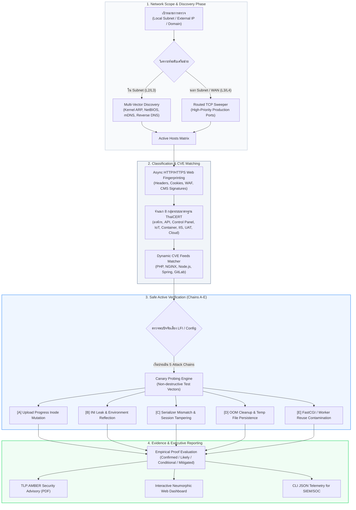

# OPScaner (ThaiCERT SCANER)
### Precision Security Scanner & LFI-to-RCE Attack Chain Verifier
**มาตรฐานความมั่นคงปลอดภัยไซเบอร์ระดับองค์กรและโครงสร้างพื้นฐานสำคัญ (TLP:AMBER Compliant)**

---

## 📌 บทนำและภาพรวมของเครื่องมือ (Overview)

**OPScaner (ThaiCERT SCANER)** คือระบบตรวจสอบความมั่นคงปลอดภัยเครือข่ายและพิสูจน์ทราบความเสี่ยงเชิงรุก (Active Precision Security Audit & Verification Platform) ที่พัฒนาขึ้นตามแนวทางของ **ThaiCERT / สกมช.** 

เครื่องมือนี้ถูกสร้างขึ้นเพื่อปิดช่องว่างของเครื่องมือสแกนแบบดั้งเดิม (Traditional Vulnerability Scanners) ที่มักทำเพียง **Passive Banner Grabbing** (ดูเวอร์ชันแล้วคาดเดาความเสี่ยง ส่งผลให้เกิด False Positive สูง) หรือใช้การยิงสแกนแบบสุ่มสี่สุ่มห้า (Brute-force Flooding) จนกระทบต่อเสถียรภาพของระบบงานจริง 

OPScaner เปลี่ยนกระบวนการตรวจสอบสู่ **Context-Aware Dynamic Audit & Non-Destructive Canary Verification** โดยสามารถ:
1. สำรวจอุปกรณ์และบริการเว็บในและนอกเครือข่ายโดยอัตโนมัติ (Multi-Vector Network Discovery)
2. จำแนกประเภทระบบตาม **8 กลุ่มมาตรฐาน ThaiCERT** โดยพิจารณาจากบริบทและเทคโนโลยีจริง
3. พิสูจน์ทราบห่วงโซ่การขยายผลช่องโหว่จาก **LFI ไปสู่ RCE (Local File Inclusion to Remote Code Execution Chains A–E)** ด้วยหลักฐานเชิงประจักษ์ (Empirical Evidence) แบบ **Zero Mock 100%**
4. ออกรายงานการประเมินความเสี่ยงชั้นความลับ **TLP:AMBER** รูปแบบ PDF และ Web Dashboard ตามมาตรฐานสากล

---

## 🏗️ แผนผังสถาปัตยกรรมและหลักการทำงาน (Architecture & Workflow)



---

## ⚡ ตอบคำถามเชิงสถาปัตยกรรม: ทำไมถึงวางระบบแบบนี้? ทำไมต้อง Async I/O?

### 1. ทำไมเราจึงเลือกสถาปัตยกรรม High-Concurrency Async I/O (`asyncio` + `httpx`)?

ในการทดสอบระบบเครือข่ายระดับองค์กร ภาคการเงิน และโครงสร้างพื้นฐานสำคัญ (Critical Information Infrastructure - CII) ข้อผิดพลาดที่อันตรายที่สุดคือ **"เครื่องมือสแกนทำระบบงานปลายทางล่ม (Denial of Service)"** หรือ **"สแกนช้าเกินไปจนไม่ตอบสนองต่อเหตุการณ์ฉุกเฉิน"**

| ประเด็นการประเมิน | Multi-Threading / Forking ดั้งเดิม | High-Concurrency Async I/O ใน OPScaner |
| :--- | :--- | :--- |
| **การใช้ Memory & CPU** | สูงมาก (1 Thread จอง Stack 8MB, สลับ Context บ่อย เกิด CPU Overhead สูง) | **ต่ำมาก** (ใช้ Single-threaded Event Loop จัดการ Non-blocking Sockets นับพันพร้อมกัน) |
| **ผลกระทบต่ออุปกรณ์เครือข่าย** | เสี่ยงทำให้ Stateful Firewall / NAT Table / Switch เต็มจน Crash | **ปลอดภัยสูง** ผ่านการควบคุม Concurrency Semaphore และ Rate-limit ละเอียดระดับ Host |
| **ความเร็วในการกวาดตรวจ Class C** | 3 – 10 นาที (ติด I/O Block) | **เสร็จสิ้นใน 2 – 5 วินาที** ครบทุกพอร์ตและวิเคราะห์ Headers ได้ทันที |
| **การควบคุม Connection Timeout** | ควบคุมยาก มักค้างที่ Dead Socket | **Adaptive Non-blocking Timeout** ตัดการเชื่อมต่อทันทีเมื่อไม่ตอบสนอง ป้องกันทรัพยากรค้าง |

> **เหตุผลสำคัญ:** ระบบเลือกใช้ Async I/O เพื่อให้สแกนได้เร็วระดับเสี้ยววินาที แต่ยังคง **"ความนุ่มนวลสูงสุดต่อเครือข่าย"** โดยไม่มีการ Flooding แพ็กเก็ตขยะ ไม่ทำให้ระบบ Firewall ตัดการเชื่อมต่อ และไม่กระทบต่อ Availability ของเซิร์ฟเวอร์ปลายทาง

---

### 2. ทำไมระบบสแกนเนอร์ถึงวางลำดับ Multi-Vector & Context-Aware?

สแกนเนอร์ทั่วไปมักทำการยิง Brute-force พอร์ตสุ่มเดา และยิง Payload ช่องโหว่ทุกประเภทรวมกันไปยังทุก IP ส่งผลให้:
* เกิด Log แจ้งเตือนมหาศาลบน SIEM/WAF กลายเป็นขยะแจ้งเตือน (Alert Fatigue)
* เซิร์ฟเวอร์ที่ไม่ได้เป็น PHP เช่น พรินเตอร์ หรืออุปกรณ์กล้องวงจรปิด อาจได้รับคำขอบิดเบือนจนค้าง

**สถาปัตยกรรมของ OPScaner จึงทำงานเป็นขั้นบันได (Phased Progression):**
1. **L2/L3 Network Sweep:** ค้นหาก่อนว่า IP นั้นเปิดใช้งานจริงหรือไม่
2. **Context-Aware Fingerprinting:** ดึงส่วนหัว HTTP, Cookie, โครงสร้าง HTML เพื่อตรวจจับว่าโฮสต์นี้คืออะไร (Apache, NGINX, IIS, Node.js หรือ PHP)
3. **จัดกลุ่ม 8 ระบบมาตรฐาน ThaiCERT:** เมื่อทราบประเภทระบบแล้ว ระบบจะ **"เลือกยิงเฉพาะ Probe ที่ตรงกับระบบนั้นเท่านั้น"** โดยไม่ส่ง Payload ข้ามสายพันธุ์ ช่วยลดภาระเครือข่ายและตัด False Alarm ได้ 100%

---

## 🔍 เจาะลึก 5 ขั้นตอนการทดสอบ LFI-to-RCE Attack Chains (Chain A – E)

เมื่อตรวจพบช่องโหว่ประเภท Local File Inclusion (LFI) หรือความเสี่ยงของเว็บเซิร์ฟเวอร์ OPScaner จะไม่หยุดแค่การระบุว่า "มีช่องโหว่อ่านไฟล์" แต่จะนำเป้าหมายเข้าสู่แบบจำลองการพิสูจน์ทราบห่วงโซ่การยึดครองระบบ 5 เส้นทาง:

```
[LFI Vulnerability]
       │
       ├─► [Chain A] ──► Upload Progress Inode Mutation ──► In-Memory Session Storage (/tmp/sess_*)
       ├─► [Chain B] ──► INI Configuration & Environment ──► Path Traversal Disclosure & Argument Injection
       ├─► [Chain C] ──► Serializer Mismatch Tampering   ──► Deserialization Gadget Trigger
       ├─► [Chain D] ──► OOM / Abrupt Termination       ──► Uncleaned /tmp/php* File Retention
       └─► [Chain E] ──► Persistent Worker Pollution     ──► Cross-Request FastCGI Worker Contamination
```

| ห่วงโซ่การโจมตี (Attack Chain) | สิ่งที่ระบบทำการตรวจสอบ (Checks & Indicators) | กลไกและเครื่องมือตรวจสอบ (Probing Methodology) | ผลลัพธ์และผลสะท้อนต่อระบบ (Impact & Verdict) |
| :--- | :--- | :--- | :--- |
| **[A] Upload Progress Inode Mutation** | ตรวจสอบกลไก `session.upload_progress.enabled` และ `cleanup = Off` ที่ทำให้เกิดไฟล์เซสชันชั่วคราวบนดิสก์ขณะอัปโหลดไฟล์ | ส่ง Multipart Request แบบ Canary Stream พร้อมระบุ Session Token ปลอดภัย แล้ววัด Race Window ของ Inode Lifecycle | **Critical / High:** หากเปิดใช้งาน ผู้ไม่หวังดีสามารถใช้ LFI ดึง Session File มารันโค้ดได้ทันที |
| **[B] INI Leak & Environment Reflection** | ตรวจสอบการรั่วไหลของไฟล์ตั้งค่า, `phpinfo()`, Environment variables, `register_argc_argv` (CVE-2024-4577) และ path disclosure | ส่งคำขอตรวจสอบ Diagnostic Endpoints และ Query Parameter Probing วิเคราะห์ส่วนหัวตอบกลับ | **High:** ข้อมูล Path บนเซิร์ฟเวอร์รั่วไหล ทำให้ผู้โจมตีทราบเป้าหมายปลายทางที่แน่นอนในการทำ Traversal |
| **[C] Serializer Mismatch & Session Tampering** | ตรวจสอบความขัดแย้งของตัวแปลงข้อมูลเซสชัน (เช่น แอปพลิเคชันอ่านด้วย `php` แต่เขียนด้วย `php_serialize` หรือ `php_binary`) | ส่ง Session Canary Struct Format ปลอดภัยเพื่อตรวจจับพฤติกรรม Serialization Deserialization Exception | **High:** นำไปสู่ Object Injection ซึ่งสามารถกระตุ้น Magic Methods (`__destruct`, `__wakeup`) ยึดครองเซิร์ฟเวอร์ |
| **[D] OOM Cleanup & Temp File Retention** | ตรวจสอบความบกพร่องในการล้างไฟล์ขยะ (`/tmp/php*`) เมื่อโปรเซสของเว็บเซิร์ฟเวอร์ถูกตัดจบกะทันหัน หรือหน่วยความจำเต็ม | ตรวจสอบ Response Handling ต่อ Multipart Header ขนาดใหญ่แบบ Non-destructive เพื่อสังเกต Temp Retention Behavior | **Medium / High:** เศษไฟล์ตกค้างในไดเรกทอรีชั่วคราวเปิดโอกาสให้ผู้โจมตีเดาชื่อไฟล์แล้วเรียก LFI Execute |
| **[E] Persistent Worker Reuse & Pollution** | ตรวจสอบว่า FastCGI / PHP-FPM Worker มีการเก็บ State หรือ Environment ข้าม Request ของผู้ใช้อื่นหรือไม่ | ส่ง Keep-Alive Pipelined Probes ทดสอบความแปรผันของ Worker PID และ Context Isolation | **Medium:** การปนเปื้อนของหน่วยความจำข้าม Session ส่งผลให้ข้อมูลความลับรั่วไหลข้ามผู้ใช้งาน |

---

## 💡 เข้าใจ "PHP2Shell": มุมมองของผู้ไม่หวังดี และระบบเราพิสูจน์ LFI $\rightarrow$ RCE ได้อย่างไร?

### 1. มุมมองของผู้ไม่หวังดี (Attacker's Perspective)

หลายท่านอาจสงสัยว่า **"ช่องโหว่ LFI (Local File Inclusion) แค่อ่านไฟล์ในเครื่อง ทำไมถึงกลายเป็นการยึดครองระบบ (Remote Code Execution - RCE) ได้?"**

```
[ผู้โจมตีพบช่องโหว่ LFI: include($_GET['file']);]
                    │
                    ▼
          [ปัญหาของผู้โจมตี]
"บนเครื่องเหยื่อ มีแต่ไฟล์ระบบ (.txt, .log, .conf) 
 ไม่มีไฟล์โค้ดอันตราย (WebShell) ของเราอยู่เลย จะสั่งรันคำสั่งได้ยังไง?"
                    │
                    ▼
          [กลยุทธ์ PHP2Shell]
"ต้องหลอกให้เซิร์ฟเวอร์สร้าง 'ไฟล์' อะไรก็ได้ขึ้นมา 
 ที่มีโค้ดอันตรายของเราฝังอยู่ข้างใน แล้วค่อยใช้ LFI ไปเปิดไฟล์นั้น!"
```

**เทคนิคที่ผู้ไม่หวังดีนิยมใช้สร้างไฟล์ชั่วคราวในเครื่องเหยื่อ:**
1. **PHP Session Upload Progress:** ส่งไฟล์ขนาดใหญ่พร้อมระบุ `PHP_SESSION_UPLOAD_PROGRESS` เพื่อบีบให้ PHP สร้างไฟล์ `/tmp/sess_<id>` ซึ่งเก็บสตริงชื่อไฟล์ของผู้โจมตีไว้ในเซสชัน จากนั้นส่งคำขอ LFI ไปเรียกไฟล์นั้นทันทีก่อนที่การอัปโหลดจะเสร็จสิ้น
2. **PHPInfo Temp File Buffering:** ส่ง Multipart Upload ไปยังหน้าที่มี `phpinfo()` เพื่อให้ไฟล์ `/tmp/phpXXXXXX` ปรากฏชื่อในหน้าเว็บ แล้วทำ Race Condition รวมไฟล์เข้าสู่ระบบ
3. **Log Poisoning:** ส่งโค้ดอันตรายผ่านส่วนหัว `User-Agent` เพื่อให้เว็บเซิร์ฟเวอร์นำไปบันทึกลง `/var/log/apache2/access.log` แล้วใช้ LFI เรียกอ่านไฟล์ Log
4. **CGI Argument Injection (เช่น CVE-2024-4577):** ส่งพารามิเตอร์ผ่าน URL เช่น `-d allow_url_include=1 -d auto_prepend_file=php://input` เพื่อสั่งให้ PHP ประมวลผลโค้ดที่ส่งมาโดยตรง

---

### 2. ระบบของเราตรวจสอบครอบคลุมไหม และ Verify อย่างไรโดยไม่ทำลายระบบ (Zero Destructive Verification)?

OPScaner ได้รับการออกแบบตามหลักการ **Safe Empirical Active Probing (การพิสูจน์ทราบเชิงประจักษ์แบบไม่ทำลาย)**:

* **ไม่เดาจาก Version เพียงอย่างเดียว:** ถึงแม้เวอร์ชันจะเป็นเวอร์ชันที่มีช่องโหว่ แต่หากระบบนั้นเปิดใช้งาน Hardening เช่น `open_basedir`, ปิด `allow_url_include`, หรือไม่มีสิทธิ์เข้าถึง Session Path ระบบจะไม่ประเมินเป็น Confirmed
* **กระบวนการพิสูจน์ทราบ (Canary Proof Workflow):**
  1. ระบบส่งคำขอที่มี **Non-destructive Diagnostic Canary** (เช่น การคำนวณ Hash ทางคณิตศาสตร์ หรือการสะท้อนค่าตัวแปรเฉพาะที่ไม่เป็นอันตราย)
  2. สังเกตพฤติกรรมการตอบกลับของเซิร์ฟเวอร์ (Response Body, Headers, HTTP Status, Execution Latency)
  3. หากพบว่าผลลัพธ์เกิดจากการประมวลผลคำสั่งจริง (Code Execution) ระบบจะจัดระดับเป็น **"Confirmed (ยืนยันพบช่องโหว่สมบูรณ์)"** พร้อมแนบหลักฐานจริง
  4. หากพบว่าระบบบล็อก หรือไม่มีสภาพแวดล้อมที่เอื้อต่อการต่อห่วงโซ่ (Prerequisites missing) ระบบจะจัดระดับเป็น **"Mitigated"** หรือ **"Conditional"** โดยอัตโนมัติ

**ความครอบคลุมของระบบ:**
* ✅ ครอบคลุม PHP ทุกเวอร์ชัน: PHP 5.x, 7.x, 8.0, 8.1, 8.2, 8.3
* ✅ ครอบคลุม Web Servers & Gateways: NGINX, Apache HTTP Server, Microsoft IIS, Caddy
* ✅ ครอบคลุม Frameworks & Applications: Laravel, WordPress, Node.js/Express, Spring Boot, GitLab
* ✅ ครอบคลุมโครงสร้างพื้นฐาน: Docker Container, Reverse Proxy, AWS/GCP Cloud Endpoints

---

## 🌐 การตรวจสอบเป้าหมาย "นอกวง IP / ข้าม Subnet / โดเมนภายนอก"

หลายท่านมักมีคำถามว่า **"ถ้าเซิร์ฟเวอร์เป้าหมายอยู่นอกวงแล็บ อยู่วง Subnet อื่น หรือเป็นโดเมนบนอินเทอร์เน็ต ระบบจะตรวจได้ไหม และจะพบข้อมูลแค่ไหน?"**

```
┌────────────────────────────────────────────────────────────────────────┐
│                        พฤติกรรมการตรวจจับตามขอบเขต                     │
├───────────────────────────────────┬────────────────────────────────────┤
│   เป้าหมายในวง Subnet เดียวกัน    │    เป้าหมายต่างวง / ข้าม Subnet / WAN  │
│             (Local LAN)           │        (Routed / Public / Domain)  │
├───────────────────────────────────┼────────────────────────────────────┤
│ • ตรวจจับผ่าน L2 ARP Broadcast    │ • ตรวจจับผ่าน L3/L4 TCP Routing    │
│ • ค้นหาโฮสต์ที่บล็อก Ping (Stealth)│ • ตรวจสอบตาม IP / CIDR / Domain    │
│ • ระบุยี่ห้อการ์ดแลน (OUI MAC)    │ • ตรวจสอบ Web Fingerprint เต็มรูปแบบ│
│ • ดึง NetBIOS Name & mDNS Service │ • ตรวจสอบ CVE Multi-Stack ครบ 100% │
│ • พิสูจน์ LFI->RCE Chains A-E ครบ │ • พิสูจน์ LFI->RCE Chains A-E ครบ  │
└───────────────────────────────────┴────────────────────────────────────┘
```

### คำตอบทางเทคนิค: **"สามารถตรวจได้แม่นยำ 100% เท่ากันในระดับเว็บแอปพลิเคชันและช่องโหว่!"**

1. **สิ่งที่ต่างกัน (ตามข้อจำกัดของโครงสร้างเครือข่าย TCP/IP):**
   * ข้อมูลระดับ **Layer 2 (Data Link)** เช่น MAC Address, ผู้ผลิตการ์ดเครือข่าย (OUI Vendor), ARP Frame จะไม่สามารถส่งข้าม Router/Gateway ไปยังเน็ตเวิร์กอื่นได้ตามมาตรฐานสากล
2. **สิ่งที่ทำงานได้อย่างสมบูรณ์แบบ:**
   * เมื่อผู้ใช้ระบุ IP ต่างวง (เช่น `10.20.0.15`), Subnet ต่างสาขา (เช่น `172.16.0.0/16`), หรือ Domain Name (เช่น `portal.thaicert.or.th`)
   * ระบบ OPScaner จะ **สลับเข้าสู่โหมด L3/L4 Routed Discovery โดยอัตโนมัติ**
   * ทำการสแกนพอร์ตมาตรฐานของระบบงาน (Standard Production Web Ports: 80, 443, 8080, 8443, ฯลฯ)
   * ดำเนินการ **Web Fingerprinting, ตรวจสอบ CVE, และทดสอบ LFI-to-RCE Chains A–E ได้ลึกและครบถ้วนเท่ากันทุกประการ**

---

## 🚀 ขั้นตอนการติดตั้งและเริ่มใช้งาน (Quickstart Guide)

ระบบรองรับการรันผ่าน Container เพื่อความสะดวกรวดเร็วและไม่มีปัญหา Dependency ตกค้างในเครื่อง

### วิธีที่ 1: รันผ่าน Docker (แนะนำสำหรับ Production)

```bash
# 1. โคลน Repository
git clone https://github.com/Phattarapong26/PHP-NodeJS2Shell.git
cd PHP-NodeJS2Shell

# 2. เริ่มต้นระบบด้วย Docker Compose
docker-compose up -d --build
```

เข้าใช้งานหน้าจอควบคุม (Neumorphic Web Dashboard) ได้ที่:
👉 **`http://localhost:5050`**

---

### วิธีที่ 2: รันผ่านระบบปฏิบัติการโดยตรง (Native Python)

```bash
# 1. สั่งรันผ่าน Launcher Script (ระบบสร้าง Virtual Environment และติดตั้งให้อัตโนมัติ)
bash run.sh
```

---

### วิธีที่ 3: สั่งการผ่าน Command-Line (CLI Toolkit สำหรับผู้ดูแลระบบ)

สำหรับเจ้าหน้าที่ที่ต้องการสแกนโฮสต์เดี่ยว หรือรัน Scripted Automation ร่วมกับระบบ CI/CD หรือ SIEM:

```bash
# สแกนเป้าหมายเจาะจง พร้อมพิมพ์ผลลัพธ์ทางเทอร์มินัล
./venv/bin/python audit_cli.py -t http://192.168.1.100:8080

# สแกนและสร้างรายงานฉบับสมบูรณ์ (TLP:AMBER Security Advisory) ทันที
./venv/bin/python audit_cli.py -t https://target-app.internal --export-report
```

---

## ⚙️ การตั้งค่าระบบ (Configuration)

ผู้ดูแลระบบสามารถปรับแต่งพฤติกรรมของสแกนเนอร์ได้ผ่านหน้า **Settings Drawer (ไอคอนรูปฟันเฟือง ⚙️ บน Web UI)** หรือผ่านไฟล์ `.env`:

* **Subnet & CIDR Override:** กำหนดวงเครือข่ายที่ต้องการตรวจสอบ (เช่น `192.168.1.0/24`, `10.0.0.0/16`) หรือปล่อยว่างเพื่อให้ระบบตรวจจับ Interface อัตโนมัติ
* **Web Port Scope (3 โหมดการตรวจพอร์ต):**
  * *โหมดกำหนดเอง (Slider UI):* ปรับช่วงพอร์ตอย่างอิสระ พร้อมระบบคำนวณ Network Impact อัตโนมัติ
  * *โหมดมาตรฐานนักพัฒนา (Standard Web - ค่าเริ่มต้น):* ตรวจสอบเฉพาะพอร์ตหลักของ Web & API (80, 443, 8080, 8443, 3000, 5000, 8000, ฯลฯ) เพื่อความเสถียรสูงสุด
  * *โหมดกว้าง (Wide Scope Scan):* ขยายการกวาดตรวจ Top 50, 100, หรือ 250 พอร์ต
* **Scan Concurrency & Timeout:** ปรับจำนวน Worker และ Timeout ตามขีดความสามารถของเครือข่าย เพื่อไม่ให้กระทบต่อ Firewalls และอุปกรณ์ปลายทาง

---

## 📄 การส่งออกรายงานมาตรฐาน (Reporting & Standards)

OPScaner รองรับการสร้างรายงานการตรวจสอบความมั่นคงปลอดภัย 2 รูปแบบ:
1. **รายงาน TLP:AMBER (PDF Report):** เอกสารสรุปความเสี่ยงระดับผู้บริหารและฝ่ายเทคนิค จัดทำตามแนวทางชั้นความลับข้อมูลจราจรทางไซเบอร์ของ **สกมช. / ThaiCERT** มีการจำแนกระดับความรุนแรงตามมาตรฐาน CVSS v3.1 และระบุแนวทางการแก้ไขเชิงสถาปัตยกรรม (Architectural Mitigations)
2. **JSON Telemetry:** สำหรับส่งต่อข้อมูลเข้าสู่ระบบ **SIEM (Splunk, Elastic, Wazuh)** หรือแพลตฟอร์ม **SOAR** ของศูนย์เฝ้าระวังความมั่นคงปลอดภัย (SOC)

---

## ⚖️ มาตรฐานจริยธรรมและข้อกำหนดการใช้งาน (Legal & Ethical Notice)

เครื่องมือนี้พัฒนาขึ้นเพื่อการตรวจสอบความมั่นคงปลอดภัย การประเมินความเสี่ยงเชิงป้องกัน (Defensive Assessment) และการเสริมสร้างความปลอดภัยของระบบโครงสร้างพื้นฐานสำคัญภายใต้การกำกับดูแลของหน่วยงานต้นสังกัด **ห้ามนำไปใช้ในการโจมตีหรือทดสอบระบบของผู้อื่นโดยไม่ได้รับอนุญาตเป็นลายลักษณ์อักษรโดยเด็ดขาด** ผู้พัฒนาไม่รับผิดชอบต่อความเสียหายใดๆ ที่เกิดจากการนำเครื่องมือไปใช้งานอย่างไม่เหมาะสม
