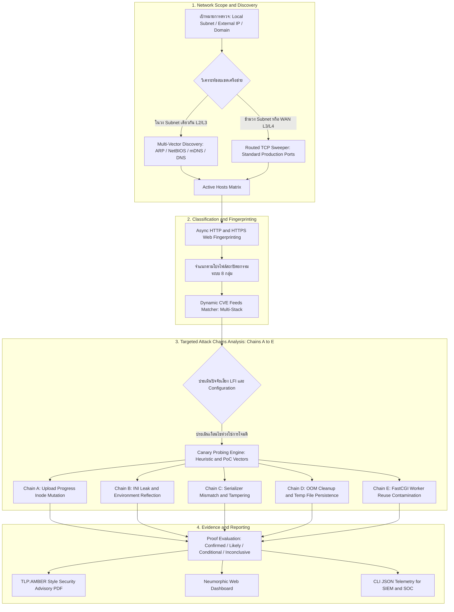

# OPScaner
### Web & Network Security Assessment Toolkit & LFI-to-RCE PoC Verifier

---

## 📌 ภาพรวมของเครื่องมือและขอบเขตทางเทคนิค (Overview & Technical Scope)

**OPScaner** เป็นเครื่องมือตรวจสอบความมั่นคงปลอดภัยเครือข่ายและเว็บแอปพลิเคชันแบบ **Blackbox (Blackbox Security Scanner & PoC Verifier)** ที่ถูกพัฒนาขึ้นเพื่อช่วยให้วิศวกรความมั่นคงปลอดภัย (Security Engineers) และผู้ดูแลระบบ สามารถสำรวจพื้นผิวการโจมตี (Attack Surface), จำแนกกลุ่มสถาปัตยกรรมระบบเว็บ, และทดสอบการขยายผลช่องโหว่จำพวก **Local File Inclusion (LFI) ไปสู่ Remote Code Execution (RCE)**

> [!IMPORTANT]
> **ข้อจำกัดและขอบเขตทางเทคนิค (Scope & Limitations):**
> * **การตรวจแบบ Blackbox:** เครื่องมือนี้วิเคราะห์ข้อมูลภายนอกที่เซิร์ฟเวอร์ตอบกลับ (HTTP Headers, Cookies, HTML Body, Status Codes, และ Error Messages) โดย**ไม่มีสิทธิ์เข้าถึง Source Code ฝั่งเซิร์ฟเวอร์จริง**
> * **เวอร์ชัน $\neq$ ความสามารถในการโจมตีจริง (Exploitability Prerequisites):** การตรวจพบเวอร์ชันซอฟต์แวร์ที่มีประวัติช่องโหว่ (เช่น Node.js หรือ PHP) เป็นเพียง **"ตัวชี้วัดความเสี่ยงเบื้องต้น (Vulnerability Indicator)"** การจะโจมตีสำเร็จได้จริงย่อมขึ้นอยู่กับเงื่อนไขเฉพาะของแอปพลิเคชัน (เช่น ช่องโหว่ Brotli ใน Node.js ต้องมีโค้ดที่รับข้อมูลจากภายนอกไปถอดรหัสผ่าน `node:zlib` จริง)
> * **การตรวจ LFI:** การส่งพารามิเตอร์ทดสอบพื้นฐาน (`?page=`, `?file=`) เป็นเพียงการตรวจจับเบื้องต้น (Heuristic Probing) **หากไม่พบข้อผิดพลาด แปลได้เพียง "ตรวจไม่พบด้วยพารามิเตอร์พื้นฐานเหล่านี้" เท่านั้น ไม่ได้รับประกันว่าระบบไม่มีช่องโหว่ LFI ในจุดอื่น**
> * **ความแตกต่างระหว่าง LFI และ RCE:** การอ่านไฟล์ระบบได้ (เช่น `/etc/passwd`) ถือเป็นช่องโหว่ **Arbitrary File Read / LFI** เท่านั้น ยังไม่นับเป็น Remote Code Execution (RCE) จนกว่าจะสามารถทำให้เกิดการประมวลผลคำสั่งหรือโค้ดบนระบบได้จริง
> * **Active Probing:** การทดสอบ PoC เช่น CVE-2024-4577 หรือการตรวจจับ Web Shell เป็นการส่งคำขอทดสอบช่องโหว่จริง (Active Probing) **ต้องใช้เฉพาะบนระบบที่ได้รับอนุญาตเป็นลายลักษณ์อักษรเท่านั้น**

---

## 🏗️ แผนผังสถาปัตยกรรมและขั้นตอนการทำงาน (Architecture & Workflow)



---

## ⚡ ทำไมจึงเลือกสถาปัตยกรรม High-Concurrency Async I/O (`asyncio` + `httpx`)?

การสแกนเครือข่ายเพื่อทำแผนที่ระบบจำเป็นต้องคำนึงถึงผลกระทบต่ออุปกรณ์ระหว่างทาง (Network Infrastructure Safety):

1. **ลดภาระทรัพยากรฝั่งเครื่องสแกน (Low Memory Footprint):**
   * โมเดล Multi-threading ดั้งเดิมจอง Stack Memory ราว 8MB ต่อหนึ่ง Thread เมื่อสแกนหลายร้อยโฮสต์พร้อมกันจะเกิด Context Switching และกินแรมมหาศาล
   * OPScaner ใช้ Single-Threaded Event Loop ร่วมกับ Non-blocking Sockets ทำให้สามารถสแกนเป้าหมายจำนวนมากพร้อมกันได้โดยใช้ Memory เพียงไม่กี่สิบเมกะไบต์
2. **ควบคุมอัตราการส่งแพ็กเก็ต ป้องกัน Network DoS (Safety & Concurrency Semaphore):**
   * การยิงคำขอเร็วเกินไปอาจทำให้ Stateful Table ของ Firewall, NAT Router หรือ Switch เต็มจนเครื่องค้าง
   * ระบบใช้ Concurrency Semaphore Pool และ Timeout ที่กระชับ (0.15s – 2.0s) เพื่อให้การกวาดตรวจเป็นไปอย่างนุ่มนวลและไม่ทำให้เซิร์ฟเวอร์ปลายทางล่ม

---

## 🔍 ห่วงโซ่การขยายผล LFI-to-RCE (Chains A – E) ตรวจสอบอะไรบ้าง?

เมื่อตรวจพบแอปพลิเคชัน PHP ระบบจะทำการประเมินว่ามีปัจจัยแวดล้อมที่อาจนำไปสู่การขยายผลจาก LFI เป็น RCE หรือไม่ โดยแบ่งเป็น 5 เส้นทาง:

| ห่วงโซ่การโจมตี (Attack Chain) | สิ่งที่ระบบทำการตรวจสอบ (Checks & Indicators) | วิธีการตรวจสอบ | ผลสะท้อนและความหมายจริง |
| :--- | :--- | :--- | :--- |
| **[A] Upload Progress Inode Mutation** | ตรวจสอบการเปิดใช้งาน `session.upload_progress.enabled` | ส่ง Multipart Request สั้นๆ พร้อม Session Key ทดสอบพฤติกรรม | หากเปิดใช้งานและมี LFI ผู้โจมตีอาจสร้างไฟล์เซสชันชั่วคราวเพื่อรันโค้ดได้ |
| **[B] INI Leak & Environment Reflection** | ตรวจสอบข้อมูลรั่วไหล เช่น `phpinfo()`, Environment Variables, Path Disclosure | ตรวจสอบ Diagnostic Endpoints และส่วนหัว Error | ข้อมูล Path ช่วยให้ผู้โจมตีระบุตำแหน่งไฟล์เป้าหมายในการทำ Traversal ได้ง่ายขึ้น |
| **[C] Serializer Mismatch & Session Tampering** | ตรวจสอบ Header / Cookie ที่บ่งชี้การใช้ Serializer ต่างชนิดกัน | วิเคราะห์ค่าตอบกลับและ Header โครงสร้างเซสชัน | ความขัดแย้งของ Parser อาจเปิดช่องโหว่ Object Injection |
| **[D] OOM Cleanup & Temp File Retention** | ตรวจสอบการจัดการไฟล์ชั่วคราวเมื่อเกิดข้อผิดพลาดในการประมวลผล | วิเคราะห์พฤติกรรมการคืนค่าเมื่อส่ง Request ขนาดใหญ่ | หากระบบลบไฟล์ชั่วคราวช้า อาจเกิดช่วงเวลา (Race Window) ให้ทำ LFI ได้ |
| **[E] Persistent Worker Reuse & Pollution** | ตรวจสอบการทำงานของ Worker (PHP-FPM / FastCGI) | ส่งคำขอ Pipelined Keep-Alive ตรวจจับ State Isolation | ประเมินความเสี่ยงของการปนเปื้อนข้อมูลระหว่าง Request |

---

## 💡 เข้าใจ "PHP2Shell": มุมมองของผู้ไม่หวังดี และการทดสอบของระบบ

### 1. มุมมองของผู้ไม่หวังดี (Attacker's Perspective)
* **ปัญหาของ LFI ทั่วไป:** ช่องโหว่ `include($_GET['file']);` ทำได้เพียงอ่านไฟล์ที่มีอยู่แล้วในเซิร์ฟเวอร์ หากเซิร์ฟเวอร์ไม่มีไฟล์ที่มีโค้ดแปลกปลอมของผู้โจมตี ก็จะไม่สามารถสั่งรันคำสั่งใหม่ (RCE) ได้
* **เป้าหมายของผู้ไม่หวังดี:** หาวิธีทำให้เซิร์ฟเวอร์ **"สร้างไฟล์อะไรก็ได้บนเครื่องที่มีโค้ดอันตรายฝังอยู่"** เช่น:
  * ฝากไว้ในไฟล์เซสชันผ่าน Session Upload Progress (`/tmp/sess_*`)
  * ฝากไว้ในไฟล์ชั่วคราวของ `phpinfo()`
  * ฉีดโค้ดผ่าน Arguments ในกรณี CGI Argument Injection (CVE-2024-4577)
  * ฉีดโค้ดลงใน Access Log ผ่านส่วนหัว User-Agent (Log Poisoning)
  เมื่อไฟล์ถูกสร้างขึ้น จึงใช้ LFI เรียกไฟล์นั้นเพื่อสั่งประมวลผลโค้ด

### 2. กระบวนการทดสอบและการแยกแยะผลลัพธ์ของ OPScaner
* **การทดสอบ LFI:** ส่งพารามิเตอร์ทดสอบพื้นฐาน (`?page=`, `?file=`) เพื่อดูว่าเซิร์ฟเวอร์ส่ง Error เกี่ยวกับ `include()` หรือ `open_basedir` หรือไม่ 
  * *ข้อควรระวัง:* หากไม่พบ Error ระบบจะบันทึกสถานะว่า **"ไม่พบข้อผิดพลาดจากพารามิเตอร์พื้นฐาน (Inconclusive)"** และไม่ถือว่าระบบปลอดภัยสมบูรณ์
* **การทดสอบ Arbitrary File Read:** หากพบว่าสามารถอ่านไฟล์คอนฟิกหรือ `/etc/passwd` ได้ ระบบจะจัดเป็น **`CONFIRMED_LFI` (ไม่ใช่ RCE)** เนื่องจากเป็นการเข้าถึงไฟล์โดยไม่ได้รับอนุญาต แต่ยังไม่มีการรันคำสั่ง OS
* **การทดสอบ RCE จริง (Active PoC):** เฉพาะกรณีที่คำขอสั่งรันโค้ดและส่งผลลัพธ์ยืนยันการประมวลผลจริงกลับมา (เช่น การทดสอบ PoC ของ CVE-2024-4577 หรือการพบ Web Shell ที่รันคำสั่งได้) ระบบจึงจะติดป้ายเป็น **`CONFIRMED_RCE`**

---

## 🏷️ โปรไฟล์สถาปัตยกรรม 8 กลุ่ม (Architecture Archetype Profiles)

เพื่อช่วยจัดหมวดหมู่ระบบที่พบในเครือข่าย ผู้พัฒนาได้จัดทำชุดโปรไฟล์สถาปัตยกรรมขึ้น 8 รูปแบบ โดยอ้างอิงจากโครงสร้างระบบไอทีที่พบได้ทั่วไปในประเทศไทย:
1. **เว็บไซต์และระบบภายในองค์กร (CMS / Internal Web):** เช่น WordPress, Drupal, หรือเว็บแอปทั่วไป
2. **ระบบหลังบ้านแอปมือถือ และ API:** เช่น Laravel, Lumen, RESTful APIs
3. **Hosting Control Panel:** เช่น cPanel, DirectAdmin, Plesk
4. **ซอฟต์แวร์และอุปกรณ์สำเร็จรูป (Appliance):** เช่น NAS, Firewall Web Admin, IoT Devices
5. **Container และ Microservices:** ระบบที่ทำงานบน Docker / Kubernetes
6. **Windows ที่มี PHP ติดตั้งอยู่:** บริการ PHP บน IIS หรือ Windows Server
7. **ระบบทดสอบ ระบบเก่า และระบบสำรอง:** ระบบ UAT, Staging, หรือเซิร์ฟเวอร์เก่าที่รอปลดระวาง
8. **ระบบที่ผู้ให้บริการภายนอกดูแล:** คลาวด์หรือ Third-party Hosted Services

> [!NOTE]
> โปรไฟล์ทั้ง 8 กลุ่มนี้เป็น **เกณฑ์การจัดหมวดหมู่เชิงสถาปัตยกรรม (Architectural Archetypes) ที่ผู้พัฒนายกร่างขึ้นสำหรับเครื่องมือนี้** ไม่ใช่มาตรฐานข้อกำหนดอย่างเป็นทางการที่ประกาศโดยหน่วยงานรัฐ

---

## 🌐 การตรวจสอบเป้าหมายนอกวง IP / ข้าม Subnet / โดเมน

* **ในวง LAN เดียวกัน (L2/L3):** สามารถค้นหาโฮสต์ได้ลึกผ่าน Kernel ARP, NetBIOS, และ mDNS แม้เครื่องเป้าหมายจะปิดกั้น ICMP Echo (Ping)
* **ข้าม Subnet / WAN / โดเมนภายนอก (L3/L4):**
  * ตามมาตรฐานเครือข่าย Frame ระดับ L2 ARP จะไม่ส่งข้าม Router
  * อย่างไรก็ดี ผู้ใช้งานสามารถระบุ IP ปลายทาง, CIDR ข้ามวง (เช่น `172.16.0.0/16`), หรือ Domain Name ได้โดยตรง
  * ระบบจะสลับเข้าสู่การสแกนผ่าน **TCP Routing & Web Handshake** เพื่อตรวจสอบพอร์ตและวิเคราะห์ช่องโหว่เว็บได้ตามปกติ

---

## 🚀 ขั้นตอนการติดตั้งและเริ่มใช้งาน (Quickstart Guide)

### 1. รันผ่าน Docker Compose (แนะนำ)

```bash
# โคลนโปรเจกต์
git clone https://github.com/Phattarapong26/PHP-NodeJS2Shell.git
cd PHP-NodeJS2Shell

# เริ่มการทำงานของระบบ
docker-compose up -d --build
```

เข้าใช้งานหน้าจอควบคุมผ่านเบราว์เซอร์ที่: **`http://localhost:5050`**

---

### 2. รันผ่าน CLI (สำหรับการทดสอบโฮสต์เดี่ยว)

```bash
# ตรวจสอบเป้าหมายเจาะจงผ่าน Terminal
./venv/bin/python audit_cli.py -t http://192.168.1.50:8080

# ตรวจสอบพร้อมสร้างไฟล์รายงานสรุปผล
./venv/bin/python audit_cli.py -t https://target-app.internal --export-report
```

---

## ⚖️ ข้อกำหนดการใช้งานและจริยธรรม (Legal & Ethical Disclaimer)

เครื่องมือนี้มีฟังก์ชันการส่งคำขอทดสอบช่องโหว่จริง (Active PoC Probing) พัฒนาขึ้นเพื่อวัตถุประสงค์ในการตรวจสอบและประเมินความเสี่ยงเชิงป้องกัน (Authorized Defensive Security Assessment) **ห้ามนำไปใช้สแกนหรือทดสอบระบบของผู้อื่นโดยไม่ได้รับความยินยอมเป็นลายลักษณ์อักษรโดยเด็ดขาด** ผู้พัฒนาจะไม่รับผิดชอบต่อความเสียหายหรือผลกระทบทางกฎหมายใดๆ ที่เกิดจากการนำเครื่องมือไปใช้งานในทางที่ผิด
