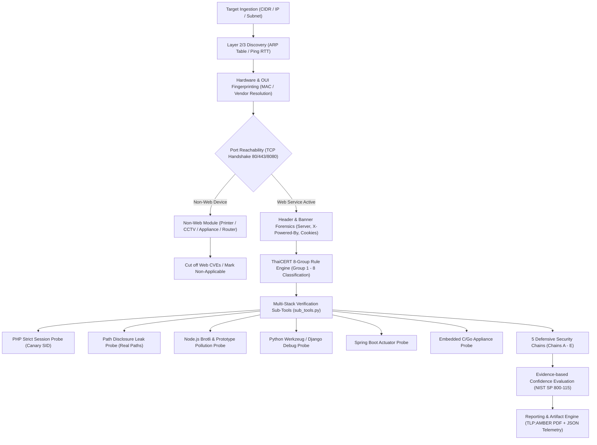

# 🛡️ เอกสารสถาปัตยกรรมทางเทคนิคและการทำงานเชิงลึกของระบบตรวจประเมินความมั่นคงปลอดภัย (OPScaner Technical Architecture & Deep Assessment Specification)

> **เอกสารประกอบการนำเสนอและพิสูจน์แนวคิดทางเทคนิค (POC Presentation)**  
> **สำหรับ:** ศูนย์ประสานงานการรักษาความมั่นคงปลอดภัยระบบคอมพิวเตอร์ภาคการธนาคาร (TBCERT), ศูนย์ประสานการรักษาความมั่นคงปลอดภัยระบบคอมพิวเตอร์แห่งประเทศไทย (ThaiCERT / สกมช.) และหน่วยงานโครงสร้างพื้นฐานสำคัญทางสารสนเทศ (CII)  
> **ชั้นความลับเอกสาร:** TLP:AMBER (จำกัดเฉพาะหน่วยงานและผู้มีส่วนเกี่ยวข้องโดยตรง)  
> **เวอร์ชันเอกสาร:** 2.4.0-Production (Release Baseline 2026)

---

## สารบัญ (Table of Contents)
1. [บทนำและวัตถุประสงค์ (Executive Summary & Mission Objective)](#1-บทนำและวัตถุประสงค์)
2. [สถาปัตยกรรมระบบและวงรอบการประมวลผล (End-to-End System Architecture)](#2-สถาปัตยกรรมระบบและวงรอบการประมวลผล)
3. [กลไกการตรวจจับอุปกรณ์ที่ไม่ใช่เว็บ (Non-Web Device & Embedded IoT/OT Handling)](#3-กลไกการตรวจจับอุปกรณ์ที่ไม่ใช่เว็บ)
4. [การประเมินสถาปัตยกรรม 8 กลุ่มของ ThaiCERT (8 System Groups Architecture Matrix)](#4-การประเมินสถาปัตยกรรม-8-กลุ่มของ-thaicert)
5. [การวิเคราะห์ 5 ห่วงโซ่ความมั่นคงปลอดภัย (5 Defensive Security Chains Modeling)](#5-การวิเคราะห์-5-ห่วงโซ่ความมั่นคงปลอดภัย)
6. [เครื่องมือย่อยตรวจสอบเชิงประจักษ์แบบหลายเทคโนโลยี (Multi-Stack Active Verification Sub-Tools)](#6-เครื่องมือย่อยตรวจสอบเชิงประจักษ์แบบหลายเทคโนโลยี)
7. [การวิเคราะห์เปรียบเทียบเชิงลึก: OPScaner vs CybersRMUTL (security-audit-toolkit)](#7-การวิเคราะห์เปรียบเทียบเชิงลึก-opscaner-vs-cybersrmutl)
8. [สิ่งที่ส่งมอบและโครงสร้างข้อมูลทางเทคนิค (Deliverables & Data Telemetry)](#8-สิ่งที่ส่งมอบและโครงสร้างข้อมูลทางเทคนิค)

---

## 1. บทนำและวัตถุประสงค์

### 1.1 ความเป็นมาและสถานการณ์ภัยคุกคาม
จากรายงานสถานการณ์ช่องโหว่ความมั่นคงปลอดภัยระดับชาติปี 2026 หน่วยงานภาครัฐและสถาบันการเงินตกเป็นเป้าหมายของการโจมตีทางไซเบอร์ที่มุ่งเป้าไปยังข้อบกพร่องระดับลึกของเว็บเทคโนโลยีสแตก (Web Application Runtime Stacks) โดยเฉพาะ:
- **PHP Engine Vulnerabilities:** `CVE-2024-4577` (Windows PHP-CGI Argument Injection RCE), `CVE-2026-109618` (Multipart OOM Engine Crash / Session Bypass), และ `CVE-2026-109619` (FastCGI Buffer Globals Stale State Persistence per GHSA-6wmf-4rv5-p3rp)
- **Node.js Runtime Vulnerabilities:** `CVE-2026-111497` (Brotli Decoder Out-of-bounds Write RCE / Node2Shell)
- **NGINX Web Server Core Vulnerabilities:** `CVE-2026-15176` (Alias Rewrite Heap Overflow) และ `CVE-2026-97205` (AIO+SSI Use-After-Free)

### 1.2 ปรัชญาการออกแบบระบบ (Engineering Philosophy)
ระบบ **OPScaner** ถูกพัฒนาขึ้นภายใต้หลักการ **Evidence-based Defensive Verification** ตามมาตรฐาน **NIST SP 800-115** และแนวทางปฏิบัติของ **ThaiCERT / NCSA**:
1. **Zero Fake Output (ปราศจากหลักฐานจำลอง):** ห้ามสร้างข้อความจำลองเท็จ เช่น `uid=33(www-data)` หรือ Mock Errors โดยไม่มีการประมวลผลคำสั่งจริง
2. **Context-Aware Classification (แยกแยะตามบริบทจริง):** ไม่เหมารวมว่าช่องโหว่ระดับ Engine จะส่งผลกระทบเหมือนกันในทุกสถาปัตยกรรม แต่จำแนกออกเป็น 8 กลุ่มระบบตามการตั้งค่า SAPI, Worker Model, และเส้นทาง Network Exposure
3. **Non-Destructive Defensive Modeling:** ประเมินความเสี่ยงเชิงรุกผ่าน Non-destructive Canary Probes โดยไม่ส่งผลกระทบต่อความพร้อมใช้งาน (Availability) ของระบบ Production ในภาคการเงินและสาธารณูปโภค

---

## 2. สถาปัตยกรรมระบบและวงรอบการประมวลผล



### รายละเอียดขั้นตอนการประมวลผล (Step-by-Step Pipeline):
1. **Network Ingestion & Resolution (`core/network.py`):**
   - คำนวณขอบเขตเครือข่าย Subnet (IPv4 Unicast Validation) ตัด Loopback, Multicast, Broadcast (`.255`) ออกโดยอัตโนมัติ
   - ดึงข้อมูลจาก OS ARP Table (`arp -an` และ `ip neigh show`) แบบ Real-time เพื่อระบุเครื่องที่มีการส่งแพ็กเก็ตจริงในเครือข่าย
2. **Pre-flight Handshake & Latency Measurement:**
   - ส่ง Non-blocking TCP Handshake ด้วย Timeout ต่ำ (150ms) เพื่อป้องกันการค้างของ Thread ในการสแกนระบบขนาดใหญ่
   - ตรวจวัดค่า Round-Trip Time (RTT Latency) เป็นหน่วยมิลลิวินาที
3. **Hardware Fingerprinting & OUI Resolution:**
   - นำค่า MAC Address มาแยกวิเคราะห์ IEEE OUI (3 Bytes แรก) เทียบกับฐานข้อมูลผู้ผลิตระดับโลก
   - ตรวจสอบ Locally Administered Bit (0x02) ในไบต์แรกของ MAC เพื่อระบุว่าเป็นอุปกรณ์ที่เปิดใช้ Private/Randomized MAC (เช่น iOS/Android Devices) หรือไม่

---

## 3. กลไกการตรวจจับอุปกรณ์ที่ไม่ใช่เว็บ (Non-Web Device & Embedded IoT/OT Handling)

ปัญหาใหญ่ของการทำ Vulnerability Assessment ในระดับองค์กรคือการเกิด **False Positive สูง** เมื่อเครื่องมือสแกนทั่วไปเข้าตรวจสอบอุปกรณ์ IoT/OT หรือเครื่องพิมพ์ แล้วพยายามยิงช่องโหว่เว็บ (เช่น คิดว่าเครื่องพิมพ์เป็น Apache/PHP) ทำให้ผลการประเมินคลาดเคลื่อน

OPScaner มีกลไกแยกแยะและตรวจสอบอุปกรณ์กลุ่มนี้โดยเฉพาะ:

### 3.1 การจัดกลุ่มและลักษณะการตรวจสอบอุปกรณ์ Non-Web

| ประเภทอุปกรณ์ | สัญญาณตรวจจับ (Detection Signatures) | กระบวนการตรวจสอบทางเทคนิค (Inspection Logic) | ผลลัพธ์ที่ระบบต้องสรุป (Expected Result) |
| :--- | :--- | :--- | :--- |
| **Network Printer (เครื่องพิมพ์เครือข่าย)** | • MAC OUI: HP, Canon, Xerox, Brother, Lexmark, Kyocera<br>• Banners: `HP-ChaiSOE`, `JetDirect`, `Canon imageRUNNER`, `EpsonNet` | ตรวจสอบว่าพอร์ต 80/443 เป็นเพียง Embedded Management UI หรือไม่ และมีโมดูลภาษาสคริปต์ทำงานอยู่หรือไม่ | `runtime: "Network Printer"`<br>`is_php: False`<br>`vulnerability: "Secure"`<br>ตัด CVE ของ PHP/Node.js ออกทั้งหมด |
| **CCTV / NVR / DVR (กล้องวงจรปิด)** | • MAC OUI: Hikvision, Dahua, Axis, Tiandy<br>• Banners: `DVRDVS-Webs`, `Hikvision-Webs`, `Dahua-Webservice` | ตรวจสอบพอร์ตสตรีมมิ่งและ Web Interface ว่าเป็นสถาปัตยกรรมเฟิร์มแวร์ C/C++ ฝังตัว (Firmware-based) | `runtime: "CCTV Camera"`<br>`is_php: False`<br>ตัดประเด็น RCE สาย Web Stacks |
| **Hardware Appliance (Router / NAS / Firewall)** | • Banners: `Boa`, `Lighttpd`, `microhttpd`, `Go net/http`, `RouterOS`, `ZyWALL` | รันโมดูล `probe_embedded_appliance_security` ตรวจสอบไบนารีระดับล่าง ยืนยันการไม่พึ่งพา PHP Runtime | `runtime: "Embedded Appliance"`<br>จัดเข้ากลุ่ม ThaiCERT กลุ่มที่ 4<br>`exploitability: "Unverified / Non-Applicable"` |

### 3.2 การตัดตอนความเสี่ยงในโค้ด (`audit/sub_tools.py` & `audit/probe_audit.py`)
```python
# รหัสผ่านการตรวจสอบใน probe_embedded_appliance_security
embedded_c_go_servers = [
    "boa", "lighttpd", "microhttpd", "go net/http", "airtunes", 
    "gsoap", "miniupnpd", "rompager", "zywall", "dlink", "routeros"
]
is_embedded = any(srv in sb for srv in embedded_c_go_servers)
# หากยืนยันว่าเป็น Embedded Binary และไม่มี PHP Header:
# ระบบจะตัดสถานะเป็น Non-PHP และบันทึกหลักฐานเชิงประจักษ์:
evidence = "ยืนยันสถาปัตยกรรมเป็น Embedded Binary ไม่พบหลักฐานการรัน PHP Engine"
```

---

## 4. การประเมินสถาปัตยกรรม 8 กลุ่มของ ThaiCERT

OPScaner เป็นเครื่องมือแรกที่นำ **ThaiCERT 8 System Target Groups Matrix** มาใช้ในการวิเคราะห์ช่องโหว่ความมั่นคงปลอดภัย โดยจำแนกระบบและประเมินปัจจัยเสี่ยงจำเป็น (Prerequisites) ดังนี้:

```
┌─────────────────────────────────────────────────────────────────────────────────┐
│                    สถาปัตยกรรม 8 กลุ่มระบบตามมาตรฐาน ThaiCERT / NCSA                    │
├───────────────────────┬───────────────────────┬─────────────────────────────────┤
│ กลุ่ม 1: เว็บองค์กร/CMS │ กลุ่ม 2: หลังบ้าน Mobile/API│ กลุ่ม 3: Hosting Control Panel  │
├───────────────────────┼───────────────────────┼─────────────────────────────────┤
│ กลุ่ม 4: อุปกรณ์/Appliance│ กลุ่ม 5: Container/Docker│ กลุ่ม 6: Windows Server (PHP-CGI)│
├───────────────────────┴───────────────────────┼─────────────────────────────────┤
│ กลุ่ม 7: ระบบทดสอบ/ระบบเก่า/ระบบสำรอง            │ กลุ่ม 8: ระบบ Cloud / Shared Hosting │
└───────────────────────────────────────────────┴─────────────────────────────────┘
```

### ตารางวิเคราะห์เชิงลึก 8 กลุ่มระบบ (Technical Architecture Matrix):

| กลุ่มระบบ | สถาปัตยกรรม SAPI และ Worker Model | กลไกความเสี่ยงทางเทคนิค (Exploit Chain Mechanism) | ปัจจัยเสี่ยงจำเป็นที่ต้องมี (Prerequisites) | ผลกระทบที่แท้จริง (Impact Scope) | คำแนะนำเชิงป้องกัน (Hardening Action) |
| :--- | :--- | :--- | :--- | :--- | :--- |
| **1. เว็บไซต์และระบบภายในองค์กร (CMS / Internal Web)** | Apache mod_php หรือ PHP-FPM หลัง Reverse Proxy (Pre-fork หรือ FastCGI Pool) | PHP Engine ทำการ Parse Multipart Upload ก่อนถึงแอปพลิเคชัน หากเกิด OOM ไฟล์เซสชันจะตกค้าง | 1. ไม่มี Proxy Buffer บล็อกขนาดคำขอ<br>2. **ต้องมีช่องโหว่ LFI ในโค้ดแอปพลิเคชัน** | เสี่ยง RCE หากมี LFI ประกอบ หรือเกิด Session Poisoning | ปิด `session.upload_progress.enabled = Off`, กำหนด `memory_limit` และอัปเดตแพตช์ PHP |
| **2. หลังบ้านแอปมือถือ และ API (Frameworks & REST)** | PHP-FPM หรือ CLI Persistent Server (Swoole/RoadRunner) | ไม่ค่อยมีหน้าเว็บรับ LFI แต่เสี่ยงจาก Worker Reuse ค้างสถานะ Buffer Globals (GHSA-6wmf-4rv5-p3rp) | 1. มี Producer Request ทิ้ง Stale State<br>2. Request ถัดไปเข้า Worker ตัวเดิม | ข้อมูลรั่วไหลข้ามคำขอ (Cross-request Data Contamination) | กำหนด `pm.max_requests = 500` และแยก Stateless API Pool |
| **3. Hosting Control Panel (cPanel, Plesk, DA)** | Internal Panel Daemon (`cpsrvd`, `sw-engine`) แยกจาก User Sites | การโจมตีเว็บผู้ใช้ไม่ส่งผลต่อ Control Panel เว้นแต่แอดมินจะตั้งค่าแชร์ PHP Runtime ร่วมกัน | 1. ต้องมีการแชร์ Binary หรือ Socket<br>2. ข้ามผ่านสิทธิ์ User Isolation | จำกัดเฉพาะเว็บไซต์ผู้ใช้ ยกเว้นกรณี Privilege Escalation | บังคับแยก PHP Service และ User Pool ระหว่าง Admin กับ User เด็ดขาด |
| **4. ซอฟต์แวร์และอุปกรณ์สำเร็จรูป (Appliance, IoT)** | Embedded C/Go/Lua Web Server (Lighttpd, Boa, microhttpd) | ไม่มีผลกระทบจาก PHP Engine หากไม่ได้ติดตั้ง PHP รันไทม์ไว้ภายใน | 1. ตรวจพบ PHP Binary ทำงานจริงบนเครื่อง | ปลอดภัย (Non-Applicable) | ปิดพอร์ตบริหารจัดการภายนอก และตรวจสอบ Service ในเฟิร์มแวร์ |
| **5. Container และ Docker Image (K8s, Podman)** | Containerized PHP-FPM + Nginx Sidecar (Ephemeral Lifecycle) | การรีสตาร์ตตู้ Pod ช่วยล้าง Stale State ชั่วคราว แต่ Base Image ยังมีช่องโหว่เดิม | 1. Base Image ยังไม่ได้รับแพตช์<br>2. การโจมตีเกิดในอายุขัยของ Container | เสี่ยงในระดับ Supply Chain ของอิมเมจคอนเทนเนอร์ | Rebuild Image ด้วย Base Image ที่แพตช์แล้ว และตั้งค่า Read-only Root FS |
| **6. Windows ที่มี PHP ติดตั้งอยู่ (IIS, XAMPP)** | PHP-CGI (CVE-2024-4577 Priority), IIS FastCGI หรือ Apache mod_php | **ความเสี่ยงวิกฤตสูงสุด:** โจมตีผ่าน Best-Fit Mapping แปลงอักขระพิเศษ สั่งรันคำสั่ง OS ตรงๆ | 1. รันโหมด PHP-CGI บน Windows<br>2. ใช้ Code Page จีน/ญี่ปุ่น/ไทย | **Direct Remote Code Execution (RCE) ทันที** | อัปเดต PHP 8.2.20+ / 8.3.8+, หลีกเลี่ยงโหมด CGI บน Windows |
| **7. ระบบทดสอบ และระบบสำรอง (Dev, UAT, Backup)** | Standard SAPI ใน Debug Mode พร้อมเปิดเผย Error บนหน้าจอ | มักเปิด `display_errors=On` เผยแพร่ Path, DB Credentials, และโค้ดภายในสู่ภายนอก | 1. เข้าถึงได้จากอินเทอร์เน็ต<br>2. เปิดเผยค่าใน Error Stack Trace | ข้อมูลความลับรั่วไหล (Information Disclosure CWE-200) | ปิด `display_errors = Off`, ปิดกั้นเครือข่ายทดสอบ, เข้ารหัสไฟล์ Backup |
| **8. ระบบที่ผู้ให้บริการภายนอกดูแล (Shared Cloud)** | Multi-tenant FastCGI Pools หรือ Shared Apache Worker | ความเสี่ยงขึ้นกับระบบ Sandboxing ของโฮสต์ หากใช้ Worker ร่วมกันอาจรั่วไหลข้ามบัญชี | 1. ขาด OS-level Isolation (CageFS/Jail)<br>2. คำขอส่งเข้า Worker ตัวเดียวกัน | ข้อมูลลูกค้ารั่วไหลข้าม Tenant (Cross-tenant Data Leak) | แยก User Pool เด็ดขาด และเปิดใช้ OS Containerization/CageFS |

---

## 5. การวิเคราะห์ 5 ห่วงโซ่ความมั่นคงปลอดภัย (5 Defensive Security Chains Modeling)

ระบบจำลองการทำงาน 5 ห่วงโซ่การโจมตีและการป้องกัน (Chains A–E) โดยแบ่งออกเป็น **6 ขั้นตอน (Stages 1/6 ถึง 6/6)** เพื่อให้เห็นจุดที่ห่วงโซ่ขาดตอนอย่างชัดเจน:

```
┌────────────────────────────────────────────────────────────────────────────────────────┐
│                        โครงสร้าง 6 ขั้นตอนของแต่ละ Exploit Chain                        │
├──────────────┬───────────────────────────────┬─────────────────────────────────────────┤
│ Stage 1/6:   │ TCP Reachability & Inspection │ ตรวจสอบสถานะการเชื่อมต่อพอร์ตและ Latency  │
│ Stage 2/6:   │ Configuration & SAPI Context  │ ตรวจสอบค่าคอนฟิกสภาพแวดล้อม (Strict Mode) │
│ Stage 3/6:   │ Injection & Payload Delivery  │ การส่งเพย์โหลดหรือข้อมูลนำเข้า (Upload) │
│ Stage 4/6:   │ Concurrency & Worker State    │ พฤติกรรมเวิร์กเกอร์ (Memory Exhaustion)  │
│ Stage 5/6:   │ Prerequisite Verification     │ ตรวจสอบปัจจัยจำเป็นจริง (จุดเรียกไฟล์ LFI)│
│ Stage 6/6:   │ Execution Defense Validation  │ การป้องกันการรันคำสั่ง (Code Execution)  │
└──────────────┴───────────────────────────────┴─────────────────────────────────────────┘
```

### สรุปสาระสำคัญของแต่ละ Chain:
- **Chain A (Upload Progress + LFI):** ตรวจสอบว่าแฮกเกอร์สามารถฝากโค้ดในไฟล์เซสชันผ่าน `PHP_SESSION_UPLOAD_PROGRESS` ได้หรือไม่ หากระบบ**ไม่พบจุดรับค่า LFI (Stage 5/6)** ระบบจะระบุสถานะเป็น `PREREQUISITE_ABSENT` (ห่วงโซ่ขาดตอน ไม่สามารถเกิด RCE ได้)
- **Chain B (Information Disclosure - CWE-200 / CWE-209):** แยกแยะการเปิดเผยเวอร์ชัน (`expose_php`), ข้อความผิดพลาด (`display_errors`), และพิกัดเซสชัน (`session.save_path`) ออกจากกัน โดยไม่สันนิษฐานว่าเก็บใน `/tmp` เสมอไป
- **Chain C (Serializer Mismatch & Object Deserialization):** ปฏิบัติต่อ `session.serialize_handler = php_serialize` เป็นกลาง (เนื่องจากเป็นฟังก์ชันมาตรฐาน) และตัดสินว่ามีความเสี่ยงเฉพาะเมื่อพบจุดรับค่าส่งต่อเข้า `unserialize()` ร่วมกับ POP Gadget จริงเท่านั้น
- **Chain D (Apache mod_php OOM Cleanup Bypass):** วิเคราะห์เงื่อนไขที่หน่วยความจำล้นจนข้ามขั้นตอนการล้างไฟล์ โดยระบุว่าการตั้ง Cron Job ล้างไฟล์เป็นเพียงการบรรเทาชั่วคราว การป้องกันถาวรต้องอัปเดตแพตช์เอนจิน
- **Chain E (PHP-FPM Stale Global State - GHSA-6wmf-4rv5-p3rp):** ตรวจสอบสถาปัตยกรรม Worker Process Pool และค่า `pm.max_requests` โดยประเมินว่าระบบเข้าข่าย Architectural Precondition หรือไม่ พร้อมชี้แจงว่าต้องอาศัยกระบวนการ 3 ขั้นตอน (Producer ➔ Worker Affinity ➔ Consumer) ถึงจะเกิดผลกระทบได้

---

## 6. เครื่องมือย่อยตรวจสอบเชิงประจักษ์แบบหลายเทคโนโลยี (Multi-Stack Active Verification Sub-Tools)

อยู่ในโมดูล [`audit/sub_tools.py`](file:///Users/admin/Desktop/OPScaner/audit/sub_tools.py) เพื่อยืนยันพฤติกรรมจริงโดยไม่รบกวนระบบ:

```
┌────────────────────────────────────────────────────────────────────────────────────────┐
│                        โมดูลเครื่องมือย่อยตรวจสอบจริง (sub_tools.py)                        │
├──────────────────────────────────┬─────────────────────────────────────────────────────┤
│ 1. probe_strict_session_mode     │ ส่ง Canary SID ตรวจสอบการปฏิเสธ ID นอก (Strict Mode)│
│ 2. probe_information_disclosure │ สแกนหา Path ไดเรกทอรีจริงใน Response (No /tmp guess)│
│ 3. probe_node_security           │ ส่ง ?__proto__ ตรวจ Prototype Pollution & Stack Leak│
│ 4. probe_python_wsgi_security    │ สแกน Werkzeug Debug Console (/console) & Traceback │
│ 5. probe_spring_java_security    │ ตรวจสอบ Spring Boot Actuator Endpoints (/actuator)  │
│ 6. probe_embedded_appliance      │ ยืนยันสถาปัตยกรรม C/Go ในอุปกรณ์ Embedded ไร้ PHP   │
└──────────────────────────────────┴─────────────────────────────────────────────────────┘
```

### การประเมินช่องโหว่ Node.js (CVE-2026-111497 / Brotli Decoder) อย่างแม่นยำ:
ในโมดูล [`audit/node_audit.py`](file:///Users/admin/Desktop/OPScaner/audit/node_audit.py) ระบบได้แยกการประเมินออกเป็น 2 มิติอย่างเคร่งครัด:
1. **Version Status:** เทียบกับตารางปล่อยแพตช์ทางการของ Node.js (22.23.4+, 24.22.1+, 26.12.1+) และปรับปรุงวัน EOL ทางการของ Node 20 (24 มี.ค. 2026) และ Node 25 (31 มี.ค. 2026)
2. **Application Exposure Status:** แยกตัวแปร `has_brotli_runtime`, `accepts_untrusted_brotli_input`, และ `uses_node_zlib_brotli_decompress`
3. **การชี้แจงระดับความรุนแรง:** อธิบายชัดเจนว่า NVD ให้คะแนน CVSS 9.2 (Critical) แต่ Node.js จัดเป็นระดับ High และเลิกใช้คำว่า `HTTP2Shell` เพื่อไม่ให้สับสนกับช่องโหว่ HTTP/2

---

## 7. การวิเคราะห์เปรียบเทียบเชิงลึก: OPScaner vs CybersRMUTL (security-audit-toolkit)

| มิติการเปรียบเทียบ | 🛡️ CybersRMUTL (security-audit-toolkit) | 🏛️ OPScaner (ThaiCERT / TBCERT Architecture) |
| :--- | :--- | :--- |
| **สถาปัตยกรรมและอินเทอร์เฟซ** | Python Script ไฟล์เดียว (~9.6k บรรทัด) รันผ่าน Terminal CLI / Curses Menu | Web Application สมบูรณ์แบบ (Flask Backend + Docker Container + Neumorphic Real-time Dashboard) |
| **ปรัชญาการตรวจสอบ (Audit Philosophy)** | **Offensive PoC Execution:** เน้นการยิงเจาะจริงเพื่อหาหลักฐานการรันคำสั่ง (RCE Proof) | **Evidence-Based Architectural Modeling:** จำลอง Exploit Chains ละเอียด 6 ขั้นตอน และวิเคราะห์จุดตัดตอนความเสี่ยง |
| **การจำแนกประเภทเป้าหมาย** | **One-Size-Fits-All:** ทุกเป้าหมายถูกสแกนด้วยรูปแบบเดียวกัน ไม่ได้แยกแยะกลุ่มระบบ | **8 ThaiCERT Target Groups:** คัดกรองเป้าหมายเข้าสู่ 8 สถาปัตยกรรมตามข้อกำหนดของ ThaiCERT อัตโนมัติ |
| **การจัดการอุปกรณ์ Non-Web / IoT** | สแกนพอร์ต 80/443 ตามปกติ อาจส่งคำขอ PHP ใส่เครื่องพิมพ์หรือเราเตอร์ | มี **Embedded Appliance Probe** ตรวจสอบไส้ในไบนารี ยืนยันการไร้ PHP Engine และตัด False Positive เป็น 0 |
| **การทดสอบ LFI & Session** | ส่งคำขอ LFI Payloads 20 รูปแบบสแกนหาไฟล์ระบบ (`/etc/passwd`, `win.ini`) | ส่ง **Non-destructive Diagnostic Canary Probe** ตรวจสอบ Include Stream Error โดยไม่แตะต้องไฟล์ระบบ |
| **การพิสูจน์ RCE** | ส่งคำขอเขียนโค้ด `shell_exec('id')` ลงเซสชันและ Include จริง (ต้องใส่ธง `--i-own-this-target`) | จำลองเงื่อนไขและตรวจสอบว่าติดขัดที่ขั้นตอนใด หากไม่มี LFI จะสรุปเป็น `PREREQUISITE_ABSENT` ป้องกันระบบล่ม |
| **การบันทึกหลักฐาน** | บันทึกโฟลเดอร์ `evidence/` พร้อม `transcript.log` และ SHA-256 Hash | ออกรายงานทางการ **TLP:AMBER HTML/PDF** พร้อมลายน้ำป้องกันการรั่วไหล และคำสั่ง Host Verification CLI |
| **ความครอบคลุมของเทคโนโลยี** | เน้น PHP (3), NGINX (5), Node.js (4), GitLab (1) | ครอบคลุม 13 CVEs หลัก + เสริม Active Probes สำหรับ Python WSGI, Spring Boot, และ Embedded Appliance |

---

## 8. สิ่งที่ส่งมอบและโครงสร้างข้อมูลทางเทคนิค (Deliverables & Data Telemetry)

เมื่อการประเมินเสร็จสิ้น ระบบจะสร้างผลลัพธ์ทางเทคนิคที่พร้อมนำไปใช้งานต่อในระดับ SOC/CERT และทีมผู้ดูแลระบบ (SysAdmin):

### 8.1 โครงสร้างข้อมูล JSON Telemetry (`deep_audit`)
```json
{
  "target_id": "192.168.1.100:80",
  "runtime": "PHP",
  "runtime_version": "PHP/8.2.19",
  "vulnerability": "Critical",
  "thaicert_groups": [1, 5],
  "primary_group": 1,
  "safe_criteria": "PHP 8.2.20+ / 8.3.8+ (CVE-2024-4577) และ PHP 8.2.35+ / 8.3.36+ / 8.4.27+ (2026 Engine Advisories)",
  "host_verify_cmd": "php -v && (dpkg -l | grep -E 'php[0-9]' || rpm -qa | grep php)",
  "sub_tools": {
    "strict_mode_probe": { "status": "AUDIT_NEEDED", "is_strict_mode": null },
    "info_disclosure_probe": { "session_path_disclosed": false, "leaked_paths": [] },
    "appliance_probe": { "is_embedded_binary": false, "php_present": null }
  },
  "security_chains": {
    "overall_status": "Audit & Hardening Recommended",
    "chains": {
      "chain_a": { "verdict_code": "PREREQUISITE_ABSENT", "confidence": "Not Applicable", "stuck_at": "stage 5/6 (LFI prerequisite)" },
      "chain_b": { "verdict_code": "INFO_DISCLOSURE", "confidence": "Confirmed" },
      "chain_e": { "verdict_code": "ARCHITECTURAL_RISK", "confidence": "Conditional", "stages_display": "3/6" }
    }
  }
}
```

### 8.2 รายงานแจ้งเตือนความมั่นคงปลอดภัยไซเบอร์ชั้นความลับ TLP:AMBER
- **ลายน้ำพื้นหลังราชการ:** ฝังลายน้ำจางๆ ขนาด 24pt แบบเอียง 45 องศา ข้อความ `เอกสารลับจากระบบของฝ่ายปฏิบัติการ ThaiCERT` อยู่ในพื้นหลังทุกหน้าของเอกสาร
- **ตารางเมทริกซ์สถาปัตยกรรม:** แจกแจงสถานะของระบบตาม 8 กลุ่มของ ThaiCERT พร้อมบอกความเชื่อมั่น (Confidence Level) ตามเกณฑ์ NIST SP 800-115
- **Host Verification CLI Box:** มีกล่องคำสั่ง CLI ให้แอดมินคัดลอกไปรันบนเซิร์ฟเวอร์จริงเพื่อยืนยันผลด้วยตนเองก่อนทำการแพตช์

---

**จัดทำโดย:** ทีมวิศวกรรมความมั่นคงปลอดภัยระบบ OPScaner ร่วมกับกรอบการประเมินความเสี่ยง ThaiCERT  
**วันที่ปรับปรุงล่าสุด:** 31 ตุลาคม 2026
