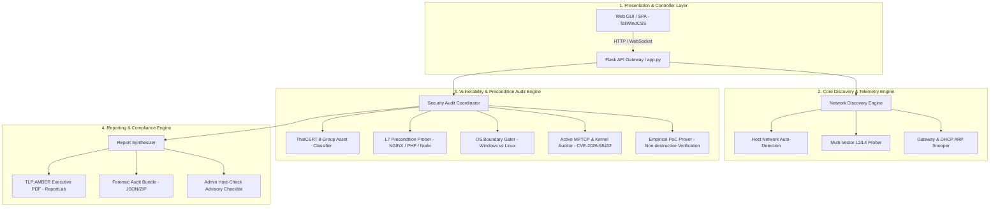

# 01. สถาปัตยกรรมระบบและการตัดสินใจเชิงวิศวกรรม
**OPScaner: System Architecture & Architectural Decision Records (ADR)**

---

## 1. ภาพรวมสถาปัตยกรรม (High-Level Architecture)

OPScaner ถูกออกแบบขึ้นมาเพื่อทำหน้าที่เป็น **ระบบประเมินความมั่นคงปลอดภัยแบบครบวงจร (Full-Spectrum Defensive Security Auditor)** ที่ครอบคลุมตั้งแต่การค้นหาอุปกรณ์ในระบบเครือข่ายภายใน (Network Discovery) ไปจนถึงการวิเคราะห์ช่องโหว่เชิงลึกของแอปพลิเคชันเว็บและระบบปฏิบัติการ (Application & OS/Kernel Vulnerability Assessment)



---

## 2. การแบ่งชั้นการตรวจสอบ 4 มิติ (4-Layer Inspection Model)

ความผิดพลาดใหญ่ของเครื่องมือสแกนแบบดั้งเดิม คือการตรวจสอบแบบ **"มิติเดียว (Single-Layer)"** เช่น ดูแค่เวอร์ชันจาก Banner แล้วฟันธงทันทีว่ามีช่องโหว่ OPScaner แก้ไขปัญหานี้โดยบังคับใช้ **โมเดลตรวจสอบ 4 มิติ**:

```
+-------------------------------------------------------------------------+
| Layer 4: Host & Kernel Verification Layer                               |
| • Active MPTCP Protocol Handshake (CVE-2026-98432 Precondition)          |
| • OS Boundary Gating (แยกเด็ดขาดระหว่าง Windows NT กับ Linux Kernel)    |
| • Host-Check Command Box (cat /etc/os-release && uname -r && EDR List)  |
+-------------------------------------------------------------------------+
                                   ▲
+-------------------------------------------------------------------------+
| Layer 3: Application & Runtime Precondition Layer                       |
| • NGINX Buffer Overflow Precondition (alias + rewrite + $request_uri)   |
| • NGINX UAF Precondition (aio on + ssi on)                              |
| • PHP SAPI Model & FastCGI Process Model (PHP-FPM vs Apache Prefork)    |
| • Brotli Compression Sink Probing                                       |
+-------------------------------------------------------------------------+
                                   ▲
+-------------------------------------------------------------------------+
| Layer 2: Transport & Edge Hardening Layer                               |
| • TCP Connect / Reset Handshake Latency Probe                           |
| • Web Application Firewall (WAF) Fingerprinting (ModSecurity/Cloudflare)|
| • Transport Security (HSTS Preload, Strict Headers)                     |
+-------------------------------------------------------------------------+
                                   ▲
+-------------------------------------------------------------------------+
| Layer 1: Network & Asset Topology Layer                                 |
| • Multi-Vector ARP & UDP Service Snooping (mDNS, SSDP, NetBIOS)         |
| • ThaiCERT 8-Group Asset Classification (CMS, API, Panel, Appliance...) |
| • Hardware MAC OUI Vendor Fingerprinting                                |
+-------------------------------------------------------------------------+
```

---

## 3. ทำไมเครื่องมือทั่วไป (Nmap, Nessus, OpenVAS) ถึง "ล้มเหลว" ในสภาพแวดล้อมจริง?

ในการตรวจสอบระบบจริง มีปัญหาคลาสสิกที่ทำให้เครื่องมือระดับโลกทำงานผิดพลาดหรือรายงานผลเพี้ยน:

| หัวข้อการเปรียบเทียบ | เครื่องมือทั่วไป (Nmap / Nessus / Masscan) | ทำไมถึงล้มเหลวหรือมีปัญหา? | แนวทางแก้ปัญหาของ OPScaner |
| :--- | :--- | :--- | :--- |
| **1. การทำงานใน Container / Docker** | • ต้องใช้สิทธิ์ `--privileged`<br>• Nmap ping scan ติดข้อจำกัด Virtual Bridge NAT<br>• ไม่เห็นเครื่องอื่นในวง Wi-Fi | Docker บน macOS / Linux ทำ NAT ข้าม VM ทำให้ Raw Socket ARP ของ Nmap สแกนข้ามเครือข่ายภายนอกไม่ติด ส่งผลให้รายงานว่า *"ไม่พบโฮสต์ใดในเครือข่าย"* | **Multi-Vector Engine** ผสานการอ่าน Host ARP Cache, การส่ง TCP SYN/Connect หลายพอร์ตพร้อมกัน, และการใช้ UDP Discovery (mDNS/NetBIOS) ผ่าน Host Network ทำให้สแกนติดทุกโฮสต์แม้รันใน Docker |
| **2. ความเสี่ยงการถูกไฟร์วอลล์บล็อก (Stealth & Evasion)** | • ส่งแพ็กเก็ตระเบิดกวาดทุกพอร์ต (Aggressive Port Sweep)<br>• พฤติกรรมเสียงดัง (Noisy Traffic) | ทราฟฟิกกระตุกไฟร์วอลล์ Stateful Inspection และ IDS/IPS (เช่น Suricata, Snort) บล็อก IP ของสแกนเนอร์ทันที ทำให้ผลสแกนหลังจากนั้นกลายเป็น Timeout ทั้งหมด | **Targeted Precondition Probing** ไม่สแกนพอร์ตแบบกวาดล้าง 65,535 พอร์ต แต่สแกนเจาะจงเฉพาะพอร์ตโครงสร้างพื้นฐานและบริการจริงด้วย Asynchronous Semaphore ควบคุม Concurrency ไม่เกิน 120-150 worker |
| **3. ความถูกต้องของเทคโนโลยี (Tech Stack Coherence)** | • อ่าน Regex จาก Banner ตัวเดียวแล้วจับคู่ CVE ทันที | เกิด **"จุดโป๊ะ"** ระดับรุนแรง เช่น เป้าหมายเป็น Windows IIS แต่กลับรายงานช่องโหว่ PHP บน Linux หรือเป้าหมายเป็น .aspx แต่รายงานช่องโหว่ PHP-CGI Argument Injection (CVE-2024-4577) | **OS Boundary Gating Engine** ตรวจสอบค่า TTL และ Server Architecture หากพบเป็น Windows จะคัดกรองช่องโหว่ Linux ทิ้งทันที และหากพบเป็น Linux จะตัดช่องโหว่ Windows CGI ทิ้ง 100% |
| **4. ผลลัพธ์ที่นำไปใช้งานได้จริง (Actionable Intelligence)** | • แสดง CVE ลิสต์ยาวเหยียด 50-100 รายการ โดยไม่บอกว่าเครื่องเสี่ยงจริงไหม | ผู้ดูแลระบบ (SysAdmin) แยกไม่ออกว่าช่องโหว่ไหนโจมตีได้จริง หรือช่องโหว่ไหนเป็นแค่ข้อมูลเวอร์ชันเก่าที่ติดแพตช์ Backport แล้ว | **Triple-Confidence Classification**: แยกผลเป็น `Confirmed` (มีหลักฐาน PoC เชิงประจักษ์), `Likely` (เงื่อนไขครบถ้วน), และ `Conditional` (เฝ้าระวัง พร้อมกล่องคำสั่ง Host-Check ให้ Admin ไปตรวจ uname -r บนเครื่องจริง) |

---

## 4. บันทึกการตัดสินใจเชิงสถาปัตยกรรม (Architectural Decision Records - ADR)

### ADR-01: ทำไมจึงเลือกใช้ Python AsyncIO แทนการเรียก Subprocess Nmap Binary?
* **บริบท**: การพัฒนาเครื่องมือสแกนเน็ตเวิร์กมักนิยมนำภาษาไพธอนไปครอบคำสั่ง `subprocess.Popen(["nmap", ...])`
* **การตัดสินใจ**: **ปฏิเสธการพึ่งพา Nmap Binary** และพัฒนาเครือข่าย Socket ด้วย `asyncio` และ `httpx.AsyncClient` ของตัวเอง 100%
* **เหตุผลทางเทคนิค**:
  1. **Portability & Container Footprint**: การติดตั้ง Nmap และ Nessus Engine ทำให้ขนาด Container ใหญ่ขึ้น 500MB–1.5GB และต้องการสิทธิ์ root/NET_RAW เสมอ
  2. **Fine-grained Protocol Probing**: Nmap ไม่สามารถทำ Stateful Handshake ขั้นสูงสำหรับช่องโหว่ยุคใหม่ได้ เช่น การทดสอบว่าเซิร์ฟเวอร์ตอบรับการบีบอัด Brotli หรือไม่, การทดสอบ MPTCP Option ด้วย Socket Protocol 262, หรือการทดสอบ Session Upload Progress ของ PHP ในรูปแบบ Non-destructive
  3. **Concurrency Control**: AsyncIO ช่วยให้ควบคุม Event Loop ได้ในระดับ Microsecond รองรับการสแกน 254 โฮสต์ใน Subnet ภายในเวลาไม่ถึง 60-70 วินาที โดยใช้ CPU และ Memory เพียงเล็กน้อย

### ADR-02: ทำไมจึงต้องมีกล่องคำสั่ง "Host-Check Checklist" ในรายงาน?
* **บริบท**: ผู้ตรวจประเมินภายนอกมักต้องการทราบว่า *"สแกนเนอร์ภายนอกรู้ได้อย่างไรว่าระบบปฏิบัติการภายในเครื่องมีช่องโหว่เคอร์เนลจริง?"*
* **การตัดสินใจ**: กำหนดให้ช่องโหว่ระดับ OS/Kernel (เช่น CVE-2026-98432) แสดงสถานะเป็น **`Conditional`** พร้อมกล่องคำสั่ง **Host-Check** เสมอ
* **เหตุผลทางเทคนิค**:
  * ตามหลักสถาปัตยกรรมเครือข่าย เครือข่ายภายนอกไม่มีสิทธิ์รันคำสั่ง Shell ในโฮสต์ปลายทางโดยพลการ
  * การอ้างว่าเจาะระบบได้โดยไม่มีหลักฐานเชิงประจักษ์ถือเป็น "รายงานปลอม (Fabricated Report)"
  * OPScaner จึงสร้างกล่องคำสั่งมาตรฐานสากล:
    ```bash
    cat /etc/os-release && uname -r && ps aux | grep -iE 'falcon|sentinel|wazuh|edr|defender'
    ```
    เพื่อให้เจ้าหน้าที่ระดับผู้ดูแลระบบสามารถนำไปรันบน Terminal เพื่อ Cross-validate ผลร่วมกับรายงานได้ทันที
