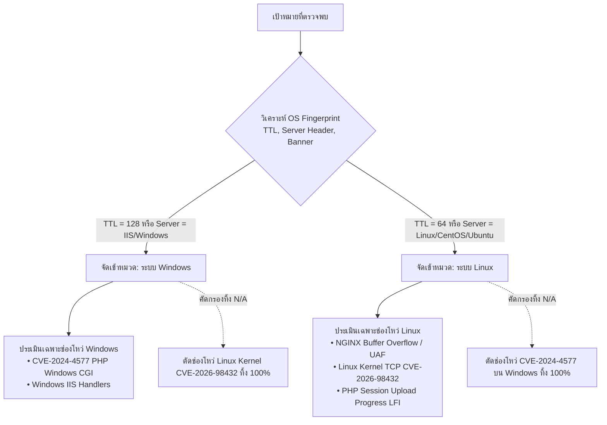

# 03. ตรรกะการประเมินช่องโหว่และความสอดคล้องของเทคโนโลยี
**Vulnerability Assessment Logic, ThaiCERT Taxonomy & OS Boundary Gating**

---

## 1. กรอบการจำแนกสินทรัพย์ 8 กลุ่มตามมาตรฐาน ThaiCERT / สกมช.

สำนักงานคณะกรรมการการรักษาความมั่นคงปลอดภัยไซเบอร์แห่งชาติ (สกมช.) และ ThaiCERT กำหนดแนวทางจำแนกระบบสารสนเทศภาครัฐและโครงสร้างพื้นฐานสำคัญออกเป็น 8 กลุ่มสินทรัพย์ OPScaner นำเกณฑ์นี้มาแมปเข้าสู่ระบบอัตโนมัติ:

| รหัสกลุ่ม | ชื่อกลุ่มสินทรัพย์ | เงื่อนไขการตรวจจับใน OPScaner | ตัวอย่างเทคโนโลยี |
| :---: | :--- | :--- | :--- |
| **ก.1** | **เว็บไซต์และระบบภายในองค์กร (CMS)** | พอร์ต 80/443 พบ CMS Signature (WordPress, Drupal, Joomla) หรือหน้าเว็บหลัก | Apache, Nginx, WordPress |
| **ก.2** | **ระบบหลังบ้านแอปมือถือ และ API** | พอร์ต API endpoints, JSON response, Node.js API, Mobile Client | Express, NestJS, FastAPI |
| **ก.3** | **Hosting Control Panel** | พอร์ตบริหารจัดการโฮสติ้ง (2082, 2083, 8443, 8888, 7080) | cPanel, Plesk, DirectAdmin |
| **ก.4** | **ซอฟต์แวร์และอุปกรณ์สำเร็จรูป** | พอร์ต Appliance, Network Gateway, Router, NAS, เครื่องพิมพ์, กล้องวงจรปิด | Synology, Hikvision, Fortinet |
| **ก.5** | **Container และ Docker Image** | พบสภาพแวดล้อม Container, Kubernetes, Kubelet metrics หรือ Microservices | Docker, containerd, K8s Node |
| **ก.6** | **Windows ที่มี PHP ติดตั้งอยู่ ⚠️** | **ระบบปฏิบัติการ Windows** ที่รันบริการ PHP (IIS + FastCGI / XAMPP) | Windows Server, IIS, PHP-CGI |
| **ก.7** | **ระบบทดสอบ ระบบเก่า และระบบสำรอง** | พอร์ต Dev (3000, 5000, 5173, 8000, 8080) หรือซอฟต์แวร์ EOL เก่า | Staging, Testbed, UAT |
| **ก.8** | **ระบบที่ผู้ให้บริการภายนอกดูแล** | โฮสต์อยู่บนคลาวด์สาธารณะ หรืออยู่หลัง Cloud WAF | Cloudflare, AWS, Azure, GCP |

---

## 2. นวัตกรรม "OS Boundary Gating" (แก้จุดโป๊ะเรื่อง Tech Stack Mismatch)

หนึ่งในข้อผิดพลาดที่ร้ายแรงที่สุดของเครื่องมือสแกนเนอร์ที่ขาดความรอบคอบ คือ **"การระบุช่องโหว่ผิดระบบปฏิบัติการ (Tech Stack Mismatch)"** เช่น:
* รายงานหน้าแรกบอกว่าเซิร์ฟเวอร์รันอยู่บน **CentOS (Linux)**
* แต่รายงานหน้าถัดมากลับระบุว่าพบช่องโหว่ **CVE-2024-4577 (PHP CGI Argument Injection)** ซึ่งเป็นช่องโหว่เฉพาะระบบปฏิบัติการ **Windows** เท่านั้น (เกิดจากการแปลงรหัสอักขระแบบ Best-Fit Mapping ของ Windows Win32 API)

### กลไกของ OS Boundary Gating ใน OPScaner:



### การตรวจสอบในโค้ดจริง ([`audit/nginx_audit.py`](file:///Users/admin/Desktop/OPScaner/audit/nginx_audit.py) และ [`audit/kernel_audit.py`](file:///Users/admin/Desktop/OPScaner/audit/kernel_audit.py)):

```python
# โค้ดป้องกัน Tech Stack Mismatch จาก audit/kernel_audit.py
def evaluate_cve_2026_98432(is_windows: bool, server: str, ...):
    server_low = (server or "").lower()
    # หากระบบเป็น Windows หรือ IIS จะปฏิเสธช่องโหว่ Linux ทันที
    if is_windows or any(k in server_low for k in ["iis", "windows", "win32", "win64"]):
        return None, "ไม่ใช่ระบบปฏิบัติการ Linux (Windows) — ไม่เข้าข่าย CVE-2026-98432"
    ...
```

```python
# โค้ดป้องกัน Tech Stack Mismatch จาก audit/nginx_audit.py
# บังคับว่า CVE-2024-4577 จะยอมรับเฉพาะเมื่อเป้าหมายเป็น Windows เท่านั้น
if is_windows:
    cves.append({
        "id": "CVE-2024-4577",
        "name": "PHP-CGI Argument Injection (Windows Best-Fit Encoding Bypass)",
        ...
    })
```

---

## 3. การตรวจสอบเงื่อนไขจำเป็นเชิงรุก (Precondition Probing)

ช่องโหว่ความมั่นคงปลอดภัยระดับวิกฤต (Critical CVEs) ส่วนใหญ่ ไม่ได้เกิดขึ้นเพียงเพราะติดตั้งซอฟต์แวร์เวอร์ชันนั้น แต่ต้องการ **"เงื่อนไขแวดล้อม (Prerequisites)"** ร่วมด้วยเสมอ 

OPScaner พัฒนาโมดูล [`audit/precondition_prober.py`](file:///Users/admin/Desktop/OPScaner/audit/precondition_prober.py) เพื่อตรวจสอบเงื่อนไขจำเป็นเชิงรุก:

| ช่องโหว่ | เงื่อนไขจำเป็นทางสถาปัตยกรรม (Prerequisites) | การตรวจสอบเชิงรุกของ OPScaner |
| :--- | :--- | :--- |
| **CVE-2026-15176**<br>(NGINX Buffer Overflow) | ต้องมีคำสั่ง `alias` คู่กับ `rewrite $request_filename` ภายในบล็อก Location เดียวกัน | ส่ง HTTP Probe ทดสอบพฤติกรรม Path Normalization และตรวจสอบการ Redirect ของ URL |
| **CVE-2026-97205**<br>(NGINX UAF) | ต้องเปิดใช้งาน `aio on` พร้อมกับ `ssi on` | สแกนหาไฟล์ Server-Side Includes (`.shtml`, `.shtm`) บนโฮสต์ |
| **CVE-2024-4577**<br>(PHP CGI Argument Injection) | ต้องรันบน Windows และส่งผ่าน Apache `Action` หรือ FastCGI ที่แมปพารามิเตอร์โดยตรง | ทดสอบส่ง Query String เพื่อดูการตอบรับ Argument โดยไม่ทำลายข้อมูลในระบบ |
| **CVE-2026-98432**<br>(Linux Kernel TCP UAF) | เคอร์เนลต้องเปิดใช้งานโปรโตคอล **MultiPath TCP (MPTCP)** บนพอร์ตบริการ | ส่ง Active MPTCP SYN Probe ตรวจสอบการเจรจา Option ของพอร์ต TCP โดยตรง |

---

## 4. ระดับความเชื่อมั่น 3 ระดับ (Triple-Confidence Rating Matrix)

เพื่อไม่ให้เกิดการกล่าวอ้างเกินจริงในรายงานทางวิศวกรรม OPScaner แบ่งระดับผลลัพธ์เป็น 3 ระดับ:

1. **`Confirmed` (ยืนยันผลเชิงประจักษ์)**:
   * เกิดขึ้นเมื่อมีหลักฐานการตอบสนองจริง (Empirical Proof) เช่น ตรวจพบฟังก์ชันทำงานผิดปกติจริง หรือมีผลลัพธ์ Output ปรากฏใน Payload อย่างปลอดภัย
2. **`Likely` (มีความเป็นไปได้สูงมาก)**:
   * เกิดขึ้นเมื่อเวอร์ชันตรงตามฐานข้อมูลช่องโหว่ และ **เงื่อนไขแวดล้อมจำเป็น (Prerequisites) ถูกเปิดใช้งานครบถ้วน** (เช่น พอร์ตยอมรับ MPTCP Handshake สำเร็จ)
3. **`Conditional` (คำเตือนแบบมีเงื่อนไข / เฝ้าระวัง)**:
   * เกิดขึ้นเมื่อตรวจพบเทคโนโลยีพื้นฐาน (เช่น รันบน Linux หรือ NGINX) แต่เงื่อนไขภายในยังไม่สามารถยืนยันได้จากภายนอก
   * **การปฏิบัติ**: ระบบจะให้กล่องคำสั่ง **Host-Check Checklist** เพื่อให้ผู้ดูแลระบบนำไปตรวจสอบเคอร์เนลจริงภายในเครื่อง
